# Manual de instalación y usuario · PanelClean 0.3.1-beta

PanelClean es una aplicación de escritorio para borrar el texto de los globos de manga y reconstruir el fondo que había detrás. La aplicación encuentra el texto de la página (o tú le indicas dónde está con un clic o un rectángulo), separa las letras del dibujo (la *máscara*), reconoce qué tipo de fondo hay detrás y elige cómo rellenarlo. Antes de guardar puedes revisar y corregir todo, y deshacer las limpiezas.

Proyecto del curso TEL-328 Procesamiento Digital de Imágenes (UTFSM, 2026).

**Contenido**

1. [Requisitos](#1-requisitos)
2. [Instalación](#2-instalación)
3. [La ventana](#3-la-ventana)
4. [Limpiar una página paso a paso](#4-limpiar-una-página-paso-a-paso)
5. [Cuando la máscara falla](#5-cuando-la-máscara-falla)
6. [Varias hojas a la vez](#6-varias-hojas-a-la-vez)
7. [Detectar texto](#7-detectar-texto)
8. [Ajustes avanzados](#8-ajustes-avanzados)
9. [Atajos de teclado y ratón](#9-atajos-de-teclado-y-ratón)
10. [Limitaciones conocidas](#10-limitaciones-conocidas)
11. [Solución de problemas](#11-solución-de-problemas)
12. [Créditos](#12-créditos)

---

## 1. Requisitos

| | |
|---|---|
| Sistema | Windows 10 u 11, probado desde un Pentium con 4 GB de RAM. Linux: incluido, sin probar |
| Python | 3.10 o superior |
| Pantalla | 1366 × 768 o más |
| Espacio | Unos 50 MB la carpeta del proyecto y unos 200 MB más al instalar |
| Internet | Solo la primera vez, para descargar NumPy, OpenCV y Pillow |

Todo lo que instala PanelClean queda dentro de su propia carpeta (en `.venv`). No modifica el Python del sistema.

## 2. Instalación

### Windows

1. **Instala Python** desde [python.org](https://www.python.org/downloads/). En la primera pantalla del instalador marca **«Add Python to PATH»**. Si ya tienes Python 3.10 o superior, salta este paso.
2. **Descarga PanelClean** desde [github.com/Tecktomi/PanelClean](https://github.com/Tecktomi/PanelClean): botón **Code → Download ZIP**, y descomprime **todo** el ZIP en una carpeta (por ejemplo, en el Escritorio). También sirve `git clone https://github.com/Tecktomi/PanelClean.git`.
3. **Haz doble clic en `INICIAR_WINDOWS.bat`**. La primera vez se abre una consola que prepara el entorno e instala las bibliotecas; tarda de 15 segundos a 2 minutos, según el equipo. Si la instalación se corta (por ejemplo, por la conexión), basta con volver a abrir el archivo: retoma sola.
4. Las veces siguientes, el mismo doble clic abre la aplicación directamente.

Si ves esta ventana, PanelClean quedó instalado. Empieza sin ninguna página abierta: pulsa **Agregar hojas** para abrir una o varias, o **Ejemplo** para practicar.

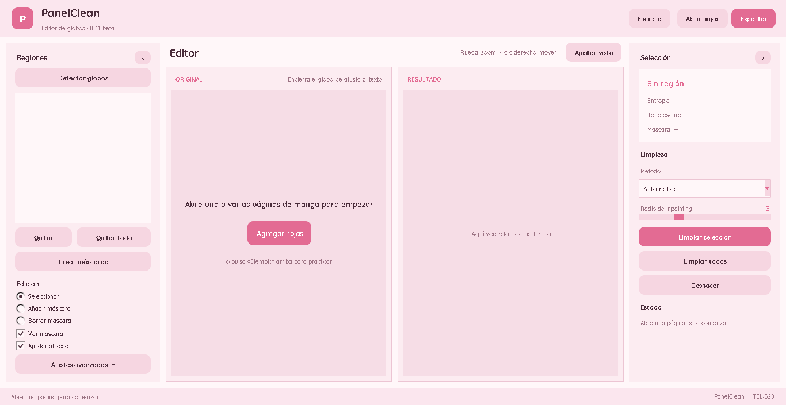

### Linux

En Debian o Ubuntu, instala primero Python, su módulo de entornos virtuales y Tkinter:

```bash
sudo apt install python3 python3-venv python3-tk
```

Luego, en una terminal, dentro de la carpeta del proyecto:

```bash
chmod +x INICIAR_LINUX.sh
./INICIAR_LINUX.sh
```

El lanzador avisa si falta algo y dice cómo instalarlo. **Sin probar:** PanelClean se probó solo en Windows 10 y 11; el equipo no tuvo un computador con Linux. Si falla, avísanos con el mensaje que muestre.

### Opciones

- **Instalar sin abrir la aplicación:** `INICIAR_WINDOWS.bat --instalar` (en Linux, `./INICIAR_LINUX.sh --instalar`).
- **Desinstalar:** borra la carpeta de PanelClean. No queda nada fuera de ella.

## 3. La ventana

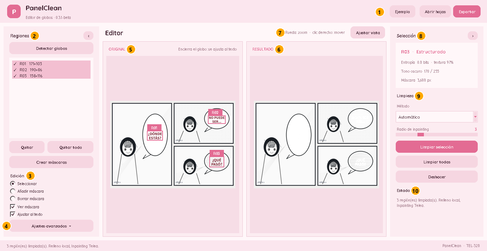

| # | Parte | Para qué sirve |
|---|---|---|
| 1 | Barra superior | **Ejemplo** abre la página incluida para practicar; **Abrir hojas** abre una o varias páginas tuyas; **Exportar** guarda el resultado de la hoja abierta |
| 2 | Regiones | **Detectar texto** busca el texto de toda la página (sección 7). Debajo, la lista de los rectángulos marcados (✓ = ya limpiada · • = tiene máscara); si no caben, la lista se desplaza. **Quitar** borra la región elegida, **Quitar todo** las borra todas y **Crear máscaras** analiza las elegidas |
| 3 | Edición | Herramienta activa: **Seleccionar** (marcar regiones), **Añadir máscara** y **Borrar máscara** (pincel). **Ver máscara** muestra u oculta el rosa. Con **Ajustar al texto**, el rectángulo que arrastras se ajusta solo a las letras (paso 2) |
| 4 | Ajustes avanzados | Afinan cómo se crea la máscara y el tamaño del pincel (sección 8) |
| 5 | Vista ORIGINAL | La página sin cambios. Aquí se marcan las letras y se ve la máscara en rosa |
| 6 | Vista RESULTADO | La página con las limpiezas aplicadas |
| 7 | Navegación | Rueda del ratón: zoom en ambas vistas a la vez, hacia el punto bajo el cursor · clic derecho y arrastrar: mover · **Ajustar vista**: volver a ver la página completa |
| 8 | Selección | Datos de la región elegida: clase de fondo, las medidas con que se decidió y, si la propuso el detector, qué tan seguro está de que es texto |
| 9 | Limpieza | **Método**, **Radio de inpainting** y los botones **Limpiar selección**, **Limpiar todas** y **Deshacer** |
| 10 | Estado | Qué acaba de pasar y qué conviene hacer después. Se repite en la barra inferior |

Pasa el cursor sobre un botón para ver una ayuda breve. Los botones pequeños **‹** y **›** junto a «Regiones» y «Selección» ocultan los paneles laterales para ver la página más grande; la franja que queda en su lugar los vuelve a mostrar. Con dos hojas o más aparece además, bajo las vistas, la tira de **Hojas** (sección 6).

## 4. Limpiar una página paso a paso

Para practicar, usa **Ejemplo**: la página tiene un globo blanco, uno sobre una viñeta punteada y uno con trama.

### Paso 1 · Abrir la página

Pulsa **Agregar hojas** (en el centro, mientras no hay ninguna página abierta) o **Abrir hojas** (`Ctrl + O`) y elige el archivo. Acepta PNG, JPG, BMP y WebP. Si eliges varios a la vez (`Ctrl` o `Shift + clic`), quedan en una cola (sección 6). Si una imagen sola mide más de 3500 px de lado, PanelClean pregunta antes de abrirla, porque procesarla toma más tiempo.

### Paso 2 · Marcar el texto

Hay tres formas, y se pueden combinar:

- **Detectar texto** (panel Regiones) busca el texto de toda la página. Las regiones de las que no está seguro quedan en naranja y no se limpian solas (sección 7).
- **Un clic sobre un globo**, en cualquier parte de su papel y fuera de las regiones, marca un punto: PanelClean agrega el texto de ese globo. Un segundo clic sobre una región naranja confirma que es texto.
- **Encerrar el globo** con un rectángulo, como se explica a continuación.

Con la herramienta **Seleccionar** y la casilla **Ajustar al texto** marcada (viene así), arrastra en la vista ORIGINAL un rectángulo **a grandes rasgos** alrededor del globo: puede incluir el contorno, el fondo de alrededor e incluso varios globos. PanelClean busca las letras dentro de esa zona y crea una región ajustada a cada bloque de texto. Cada región se llama R01, R02…; si quitas una, su número queda libre para la siguiente.

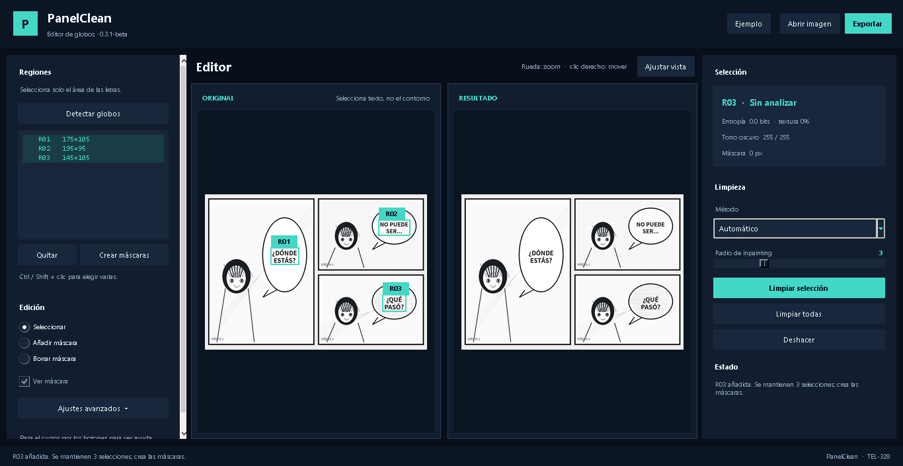

Para encontrar las letras, PanelClean busca lo oscuro que el papel del globo rodea por completo; por eso no lo confunden ni el fondo negro ni la trama de alrededor. Antes lleva el papel de la página a un mismo tono, así también funciona con escaneos grises, amarillentos o lavados. Si no encuentra texto (por ejemplo, porque está escrito sobre el dibujo), usa el rectángulo tal como lo marcaste y lo avisa en la barra de estado; si el rectángulo es muy grande para ser solo texto, no crea ninguna región. En ese caso, o si desmarcas **Ajustar al texto**, el rectángulo debe quedar **ajustado a las letras**, sin el contorno del globo.

- Un clic sobre una región la elige; `Ctrl + clic` la suma o la quita de la selección. En la lista, `Ctrl` o `Shift + clic` eligen varias.
- Las regiones elegidas se ven en rosa cerezo; las demás, en malva.
- Un rectángulo más chico que 12 × 12 px no se acepta.
- Revisa los rectángulos: a veces aparece una región chica sobre un trozo de dibujo encerrado por papel blanco (una línea punteada del borde del globo, por ejemplo). Elígela y pulsa **Quitar**.
- Al marcar a mano (sin **Ajustar al texto**), si un globo tiene texto en dos zonas separadas, marca dos regiones: cuanto menos dibujo quede dentro, mejor sale la máscara.

### Paso 3 · Crear las máscaras

Pulsa **Crear máscaras**. Las letras que PanelClean va a borrar se tiñen de rosa.

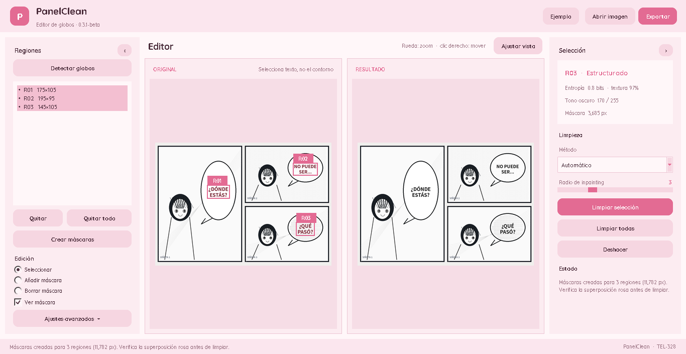

**Revisa el rosa antes de limpiar.** Todo lo rosa se va a borrar y reconstruir. Si cubre parte del dibujo o deja letras sin cubrir, corrígelo (sección 5).

### Paso 4 · Revisar el tipo de fondo

El panel **Selección** muestra la clase de fondo que PanelClean encontró detrás de las letras. Con el método **Automático**, la clase decide cómo se limpia:

| Clase | Qué hay detrás de las letras | Qué hace el modo Automático |
|---|---|---|
| **Uniforme** | Papel liso, blanco o gris | **Relleno local**: pinta con el tono del papel que rodea a las letras |
| **Estructurado** | Trama de puntos, rayado o degradado, sin negro | **Inpainting Telea**: reconstruye el fondo a partir de sus bordes |
| **Complejo / revisar** | Dibujo, con trazos negros | No limpia: queda para que la revises (sección 5) |
| **Revisar máscara** (en naranja) | La máscara cubre más del 36 % de la región (55 % si la región se ajustó sola a las letras), o la región ocupa más del 5 % de la página (y más de 40 000 px) | No limpia: probablemente la máscara incluye dibujo |

Las medidas del panel explican la decisión: la **entropía** indica cuántos tonos distintos hay en el fondo (pocos = papel liso), la **textura** qué parte del fondo tiene trama, y el **tono oscuro** cuán oscuro es lo más oscuro del fondo (cerca de 0 = hay tinta de dibujo).

Si no estás de acuerdo, elige otro **Método** en el panel Limpieza: se aplica a las regiones elegidas.

### Paso 5 · Limpiar

- **Limpiar selección** limpia las regiones elegidas en la lista.
- **Limpiar todas** intenta limpiar todas; las que quedan para revisión no se tocan.

La barra de estado dice cuántas se limpiaron, con qué método y cuáles quedaron pendientes. La limpieza **nunca cambia un píxel fuera de la máscara**. Con la rueda del ratón puedes acercarte para comparar ambas vistas:

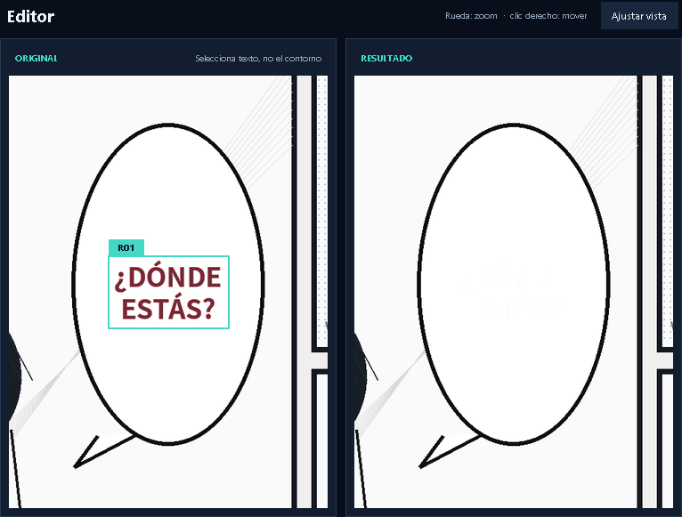

### Paso 6 · Comparar, deshacer y quitar

- **Deshacer** (`Ctrl + Z`) vuelve atrás la última limpieza o la última región quitada, hasta 15 pasos (menos en páginas muy grandes, para no llenar la memoria). Los trazos del pincel no se deshacen: se corrigen con **Añadir máscara** o **Borrar máscara**.
- **Quitar** (`Supr`) borra la región elegida y también su limpieza del resultado; **Quitar todo** borra todas las regiones. Ambos se pueden deshacer.
- Puedes volver a limpiar una región con otro método: el resultado se recalcula siempre desde la página original, así que las limpiezas no se acumulan ni se degradan.

### Paso 7 · Exportar

Pulsa **Exportar** (`Ctrl + S`) y elige dónde guardar. Se crean tres archivos; tu imagen original no se modifica:

| Archivo | Contenido |
|---|---|
| `nombre.png` | La página limpia |
| `nombre_mascara.png` | La máscara de todas las regiones limpiadas (blanco = píxel reconstruido) |
| `nombre_reporte.json` | Por región: posición, si se limpió, clase de fondo, método usado, medidas del fondo y píxeles de la máscara |

## 5. Cuando la máscara falla

La máscara se calcula por el tono, el tamaño y la forma de los trazos, no por el significado de las letras. PanelClean ya descarta por sí solo lo que entra por el borde de la selección y sigue fuera de ella (una sombra, el borde del globo, un trazo de dibujo), pero todavía puede equivocarse de dos maneras.

**Faltan letras o signos.** Las piezas muy pequeñas, como puntos o comas, pueden quedar sin rosa. En este ejemplo real, la máscara cubre «かっ» pero no los puntos suspensivos:

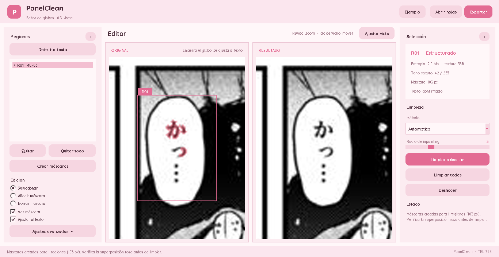

Para corregirla:

1. Elige la región y la herramienta **Añadir máscara**. El tamaño del pincel está en Ajustes avanzados.
2. Pinta sobre lo que falta. Al soltar el botón, el fondo se vuelve a analizar.
3. Limpia otra vez. En este caso, el rectángulo toca el fondo negro de fuera del globo, así que el análisis dice **Complejo / revisar** y el modo automático no lo limpia. Como detrás de las letras hay papel blanco, elige **Relleno local** en Método y pulsa **Limpiar selección**.

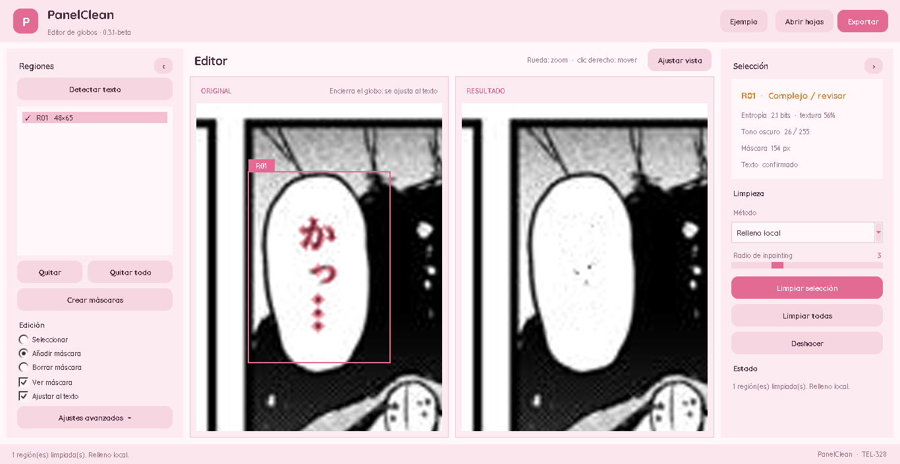

Si después de limpiar quedan motas sueltas, como aquí junto a la «っ», un toque más con **Añadir máscara** y otra limpieza las borran.

**Sobra dibujo.** Si dentro de la selección hay un trazo de dibujo tan oscuro y delgado como una letra, puede quedar marcado. Bórralo con la herramienta **Borrar máscara** antes de limpiar. Esto importa más de lo que parece: si el dibujo queda dentro de la máscara, lo que rodea a las letras parece papel liso, la clase dice **Uniforme** y la limpieza pintaría ese dibujo de blanco. Por eso conviene revisar siempre el rosa.

**Otras formas de arreglarlo:**

- **Ajustar el rectángulo**: quita la región y márcala de nuevo más ajustada, o divídela en dos (para que quede tal cual, desmarca **Ajustar al texto**).
- **Sensibilidad** (Ajustes avanzados): súbela si faltan signos pequeños en muchas regiones.
- **Crear máscaras** otra vez descarta las correcciones hechas con el pincel; por eso pregunta antes.
- **Dejarla para el final**: una región en «Complejo / revisar» no se limpia sola. Puedes elegir un método a mano o limpiarla en otro editor.

## 6. Varias hojas a la vez

Para limpiar un capítulo, abre todas sus páginas juntas: en el diálogo de **Abrir hojas**, elige varias con `Ctrl` o `Shift + clic`. Quedan en una cola, que se ve como una tira de miniaturas bajo las vistas:

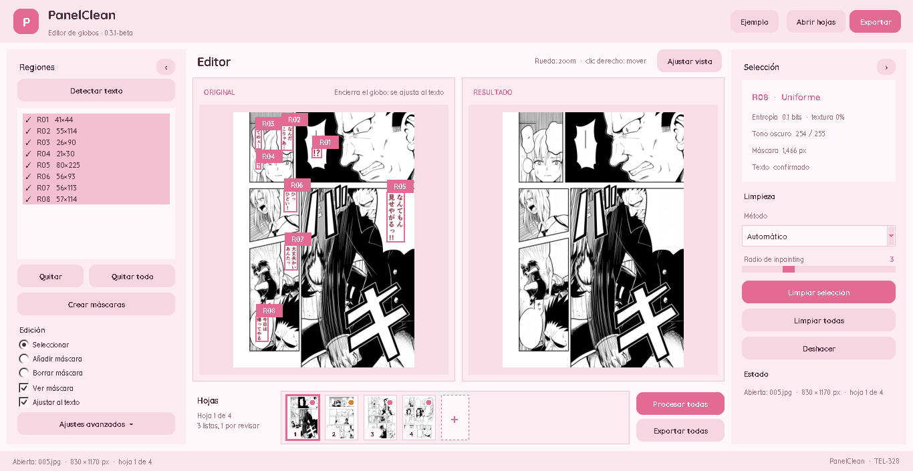

- **Pasar de una hoja a otra:** clic en su miniatura, o `Re Pág` y `Av Pág`. Cada hoja guarda sus regiones, máscaras y limpiezas, y al volver a ella sigue igual. Una hoja que no está abierta conserva sus 3 últimos pasos de **Deshacer**.
- **Estado de cada hoja**, en el punto de su miniatura: malva = pendiente, rosa = lista (todas sus regiones limpias), naranja = por revisar (quedaron regiones sin limpiar o no se encontró texto). Al pasar el cursor por una miniatura se ven su nombre y su estado.
- **Sumar hojas:** el **+** al final de la tira las agrega a la cola. **Abrir hojas**, en cambio, reemplaza las que hay; si alguna tiene limpiezas sin exportar, PanelClean pregunta antes.

**Procesar todas** limpia la cola completa, una hoja tras otra: crea las máscaras que falten y limpia cada región con su método (Automático, salvo que hayas elegido otro). Las regiones dudosas quedan sin limpiar y la hoja queda en naranja. Mientras trabaja, el botón cambia a **Detener**.

En las hojas sin regiones, PanelClean busca el texto con **Detectar texto** (sección 7) y tiene en cuenta los puntos que hayas marcado en ellas. Lo más rápido es abrir las hojas, pulsar **Procesar todas** y después revisar las hojas en naranja. Si en alguna hoja el detector no encuentra un globo, un clic sobre él basta.

**Exportar todas** pide una carpeta y guarda ahí cada hoja que tenga alguna limpieza, como `nombre_limpia.png` junto con su máscara y su reporte (los mismos tres archivos del paso 7). Si dos hojas se llaman igual, la segunda queda como `nombre_limpia_2.png`. Las hojas sin limpiezas no se exportan; al terminar, PanelClean indica cuáles quedaron con regiones sin limpiar. **Exportar**, en la barra superior, sigue guardando solo la hoja abierta.

## 7. Detectar texto

**Detectar texto** busca el texto de toda la página en dos pasos:

1. Propone como candidatos los bloques oscuros que el papel rodea por completo (la misma búsqueda de **Ajustar al texto**), probando varios tamaños de letra. Así aparece casi todo el texto de los globos, pero también trozos de dibujo.
2. Un modelo entrenado con páginas de manga reales decide, para cada candidato, qué tan seguro está de que es texto. Para eso mira 17 medidas del bloque: el grosor y la regularidad de los trazos, cuánto se parecen las piezas entre sí, si forman columnas o renglones, cuánto papel blanco hay alrededor, si está dentro de un globo, entre otras. Si varios candidatos se solapan, queda el bloque más completo.

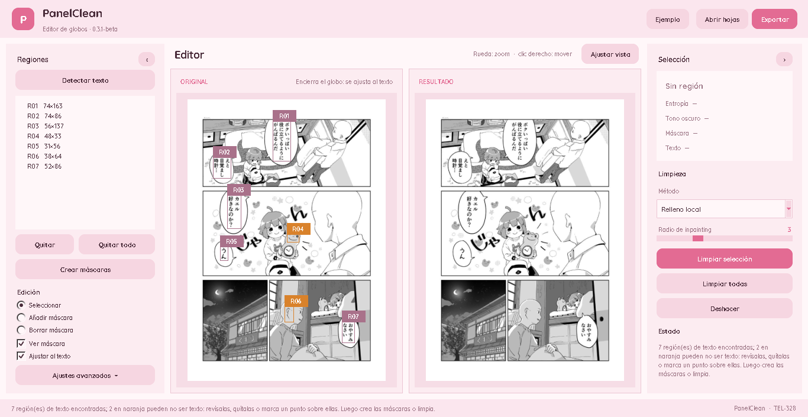

- Las regiones **seguras** (malva, o rosa cerezo si están elegidas) se limpian solas con **Limpiar todas** o **Procesar todas**.
- Las **dudosas** quedan en **naranja** y el modo automático no las limpia. El panel Selección muestra qué tan seguro está el detector («Texto 42 % seguro · revisar»). Si una región naranja sí es texto, haz un segundo clic sobre ella para confirmarla; si no lo es, pulsa **Quitar**.
- Un **punto** (un clic sobre el papel de un globo, fuera de las regiones) confirma el texto de ese globo. Si el detector no lo había propuesto, PanelClean lo busca ahí mismo, con el tono de papel de ese lugar. Se ve como un círculo rosa; otro clic sobre el punto lo quita. Los puntos se guardan con cada hoja y **Detectar texto** los tiene en cuenta; lo que no tiene un punto no pierde nada.

Con todo el texto marcado, la página queda así:

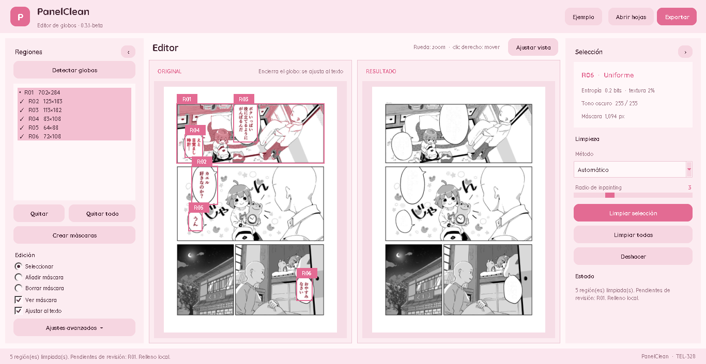

**Qué esperar.** El detector aprendió sobre todo con manga en japonés. En páginas de OpenMantra encuentra cerca de 9 de cada 10 textos, pero **en una serie en español que no había visto encontró el 64 %** con confianza suficiente para limpiar solo, y el 74 % después de enseñarle otras páginas de esa misma serie (casi todo lo que propuso era texto). Con esa serie se ajustó el detector, así que con otra puede irle algo peor. Las cifras están en los [resultados de la evaluación](evaluacion/resultados/resumen.md). Lo que más se le escapa son las palabras sueltas muy chicas («¡HOP!»), los puntos suspensivos solos y las letras que tocan el borde del globo. El texto sobre dibujo y el de globos oscuros casi nunca se propone. Para todos esos, haz clic en el globo o marca la zona a mano.

### Enseñarle tus páginas al detector

1. Junta en una carpeta las páginas de **una** serie. Conviene enseñarle pocas páginas de varias series, cada una en su carpeta, antes que muchas de una sola.
2. Arrastra esa carpeta encima de `MARCAR_WINDOWS.bat` (o haz doble clic en él y elígela). En Linux: `.venv/bin/python -m evaluacion.marcar ruta/a/la/carpeta`.
3. En cada página aparecen, punteadas, las cajas que propone el detector. Corrígelas hasta que haya **un rectángulo por cada bloque de texto, ajustado a las letras** (no al globo):

   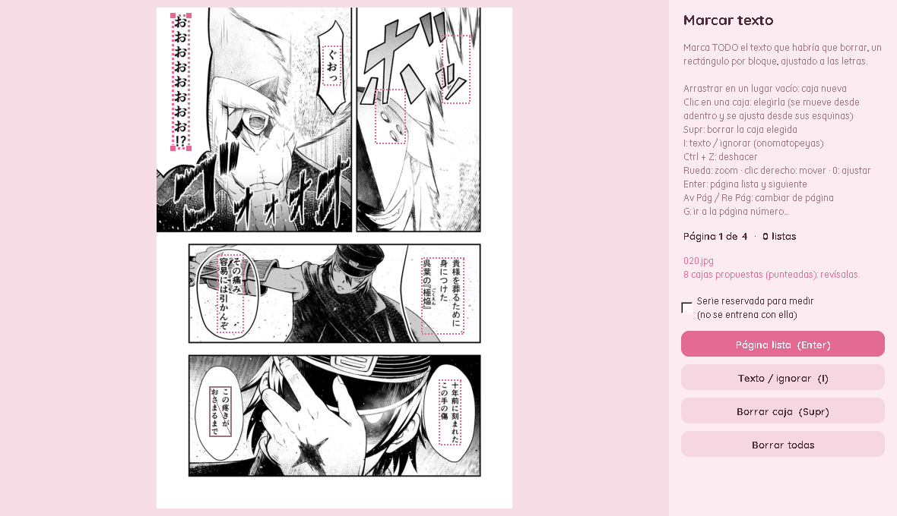

   | Para… | Hacer |
   |---|---|
   | Agregar una caja | Arrastrar en un lugar vacío |
   | Mover o ajustar una caja | Clic para elegirla; arrastrarla desde adentro o desde una esquina |
   | Borrar una caja | Elegirla y `Supr` |
   | Marcar una onomatopeya o un letrero del dibujo | Elegirla y `I` («ignorar»: no cuenta ni como texto ni como «no texto») |
   | Deshacer | `Ctrl + Z` |
   | Acercar, mover y volver a ver todo | Rueda, clic derecho y `0` |
   | Terminar la página | `Enter` (pasa a la siguiente) |

4. Marca **todo** el texto antes de pulsar `Enter`: lo que quede sin marcar en una página lista se aprende como «no texto». Una página sin terminar se guarda, pero no se usa.
5. Al cerrar la ventana, acepta entrenar. Tarda uno o dos minutos y PanelClean lo usa la próxima vez que se abra.

**Para saber cómo le va de verdad**, reserva una serie: marca la casilla **Serie reservada para medir** antes de empezar. Con ella no se entrena y no se muestran propuestas. El informe que aparece al entrenar dice, por serie, qué parte del texto llega a proponerse («candidatos») y la precisión y el recall. Si «candidatos» es bajo, ese texto no se arregla enseñándole más páginas.

Tus imágenes no se copian a ningún lado, y no hace falta compartirlas (pueden tener derechos de autor). En `evaluacion/cajas_texto.json` quedan las cajas, con el nombre de la carpeta y de los archivos. Para compartir lo aprendido con el equipo basta con subir ese archivo, `evaluacion/candidatos_propios.csv` y `panelclean/modelo_texto.yml`: son números, y con ellos no se puede reconstruir una página.

## 8. Ajustes avanzados

Se abren con **Ajustes avanzados** en el panel izquierdo. Después de cambiar uno, pulsa **Crear máscaras** para recalcular.

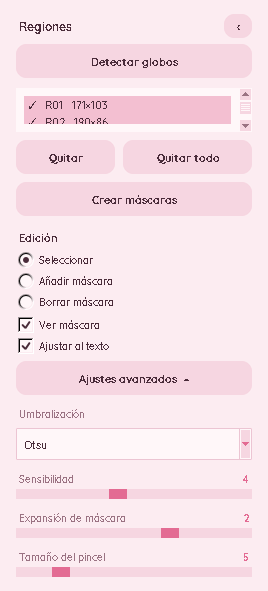

| Ajuste | Qué hace | Cuándo cambiarlo |
|---|---|---|
| **Umbralización** | Cómo se separa la tinta del fondo. **Otsu** usa un único umbral para toda la región; **Adaptativo** calcula uno distinto en cada zona | Adaptativo, si el fondo es un degradado o está más oscuro de un lado |
| **Sensibilidad** (1-8, por defecto 4) | Tamaño mínimo de una pieza de tinta para considerarla parte de una letra: 7 píxeles de área con 1, 3 con 8 | Súbela si faltan puntos, comas o marcas pequeñas; bájala si aparecen motas sueltas |
| **Expansión de máscara** (0-3, por defecto 2) | Cuántos píxeles crece la máscara alrededor de las letras, solo sobre tinta, para no dejar un borde gris | Súbela si queda el contorno de las letras tras limpiar; bájala si la limpieza se come detalles del fondo |
| **Tamaño del pincel** (2-20) | Radio del pincel de Añadir y Borrar máscara, en píxeles de la imagen | Chico para detalles, grande para zonas amplias |
| **Radio de inpainting** (1-8, panel Limpieza) | Cuánto alrededor mira el inpainting para reconstruir | Más alto suaviza más; más bajo conserva mejor los bordes |

## 9. Atajos de teclado y ratón

| Acción | Atajo |
|---|---|
| Abrir hojas | `Ctrl + O` |
| Exportar | `Ctrl + S` |
| Deshacer | `Ctrl + Z` |
| Quitar la región elegida | `Supr` |
| Volver a la herramienta Seleccionar | `Esc` |
| Hoja anterior / siguiente | `Re Pág` / `Av Pág` |
| Marcar un punto donde hay texto (o quitarlo) | Clic sobre el globo, fuera de las regiones |
| Confirmar que una región naranja es texto | Segundo clic sobre ella |
| Zoom | Rueda del ratón sobre una vista (acerca hacia el cursor) |
| Mover la vista | Clic derecho y arrastrar |
| Elegir varias regiones | `Ctrl + clic` en la vista; `Ctrl` o `Shift + clic` en la lista |

## 10. Limitaciones conocidas

PanelClean es una beta. Estas son sus limitaciones medidas; el detalle está en [`evaluacion/resultados/resumen.md`](evaluacion/resultados/resumen.md).

- **Tramas y degradados.** El inpainting no reproduce bien un patrón regular: donde estaban las letras queda una zona más clara o borrosa.

  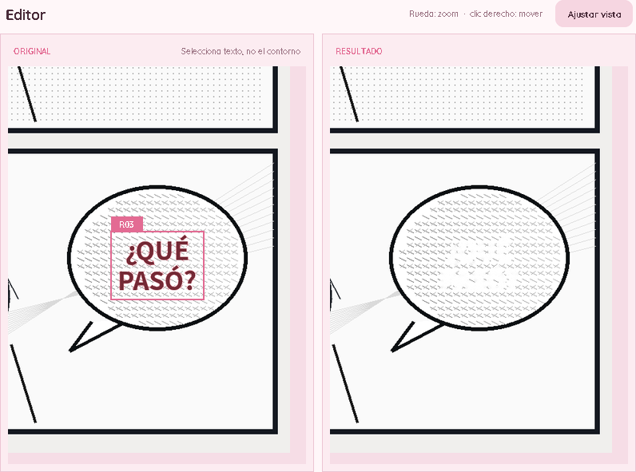

- **Texto sobre dibujo.** La máscara confunde con letras los trazos de dibujo de grosor parecido (sección 5), y cuando las letras tienen un borde blanco suele quedar su silueta. Es el caso con peores resultados en las pruebas.
- **Letras blancas sobre fondo negro.** No se detectan: la máscara busca tinta oscura. (El texto negro con borde blanco sobre un fondo oscuro sí se detecta.)
- **Ajustar al texto.** Solo encuentra texto rodeado de papel. Con texto sobre dibujo usa el rectángulo tal cual, y a veces suma una región chica sobre dibujo encerrado por papel (sección 4, paso 2).
- **Detectar texto.** Aprendió sobre todo con manga en japonés. En una serie en español que no había visto encontró el 64 % del texto: revisa lo naranja, haz clic en lo que falte o enséñale tus páginas (sección 7). Si la página tiene una sombra fuerte (una foto, el lomo de un tomo), la detección automática pierde cerca de la mitad del texto; los clics siguen funcionando.
- **Clasificación del fondo.** Acierta bien en papel liso, pero con tramas finas reales se equivoca más que con dibujo. Revisa la clase en el panel Selección.
- **Restos.** En algunos globos queda un moteado gris muy tenue donde estaban las letras, sobre todo en páginas con mucha compresión JPEG. Se nota al mirar de cerca y se borra con **Añadir máscara** o subiendo la **Expansión**. También pueden quedar signos muy pequeños sin borrar (sección 5).

## 11. Solución de problemas

| Problema | Qué hacer |
|---|---|
| «No se encontró Python 3.10 o superior» | Instala Python desde python.org marcando «Add Python to PATH» y vuelve a abrir `INICIAR_WINDOWS.bat` |
| «No se pudieron instalar las dependencias» | Revisa la conexión a Internet y vuelve a abrir el lanzador: la instalación se reintenta sola |
| Linux: «Falta Tkinter» | `sudo apt install python3-tk python3-venv` |
| `ModuleNotFoundError: No module named 'PIL'` (o `cv2`) al correr un `.py` | Se usó el Python del sistema. Abre PanelClean con el lanzador, o usa `.venv\Scripts\python` (Linux: `.venv/bin/python`) |
| Una región no se limpia | Está en «Complejo / revisar» o «Revisar máscara», o su máscara quedó vacía. Revisa el rosa, corrígelo o elige un método a mano |
| Al arrastrar no se crea un rectángulo | La herramienta activa es un pincel. Pulsa `Esc` o elige **Seleccionar** |
| La región no quedó donde arrastré | Con **Ajustar al texto**, la región se ajusta a las letras que encontró en la zona. Para usar el rectángulo tal cual, desmarca la casilla |
| Detectar texto no encuentra el texto de mis páginas | Haz clic sobre cada globo que falte, o enséñale algunas de tus páginas con `MARCAR_WINDOWS.bat` (sección 7) |
| «No encontré texto en esa zona y es muy grande…» | Encierra un globo por vez, o desmarca **Ajustar al texto** y marca solo las letras |
| Un clic sobre la página deja un círculo rosa | Es un punto de texto (sección 7). Otro clic sobre él lo quita |
| No puedo cambiar de hoja | Mientras corre **Procesar todas** no se puede; espera o pulsa **Detener** |
| El pincel no hace nada | Hay que elegir antes una región (un clic sobre ella) y pintar dentro de su rectángulo |
| La ventana no cabe en la pantalla | En pantallas chicas PanelClean se abre maximizada; los paneles laterales se pueden ocultar con sus botones **‹** y **›** |
| Va lento | Pasa con páginas muy grandes. En un portátil común, detectar y limpiar una página de 2048 px toma menos de 1 s |

## 12. Créditos

- **Equipo:** Jesús Ignacio Bustamante Llanquitrue, Patricio Marcelo Guzmán Aranda, Sofia Victoria Nicolao Madrid y Tomás Ramdohr Arellano.
- **Páginas reales de este manual:** obras «rasetugari», «tencho_isoro» y «tojime_no_siora» del **OpenMantra dataset** (R. Hinami, S. Ishiwatari, K. Yasuda y Y. Matsui, AAAI 2021), licencia CC BY-NC 4.0. Créditos completos en [`datasets/README.md`](datasets/README.md).
- **Página de ejemplo** (`examples/demo_pagina.png`): sintética, hecha por el equipo.
- **Fuente de la interfaz:** Quicksand, de The Quicksand Project Authors ([github.com/andrew-paglinawan/QuicksandFamily](https://github.com/andrew-paglinawan/QuicksandFamily)), licencia SIL Open Font License 1.1 (incluida en `panelclean/fuentes/OFL.txt`).
- Bibliotecas: OpenCV, NumPy, Pillow y Tkinter.
